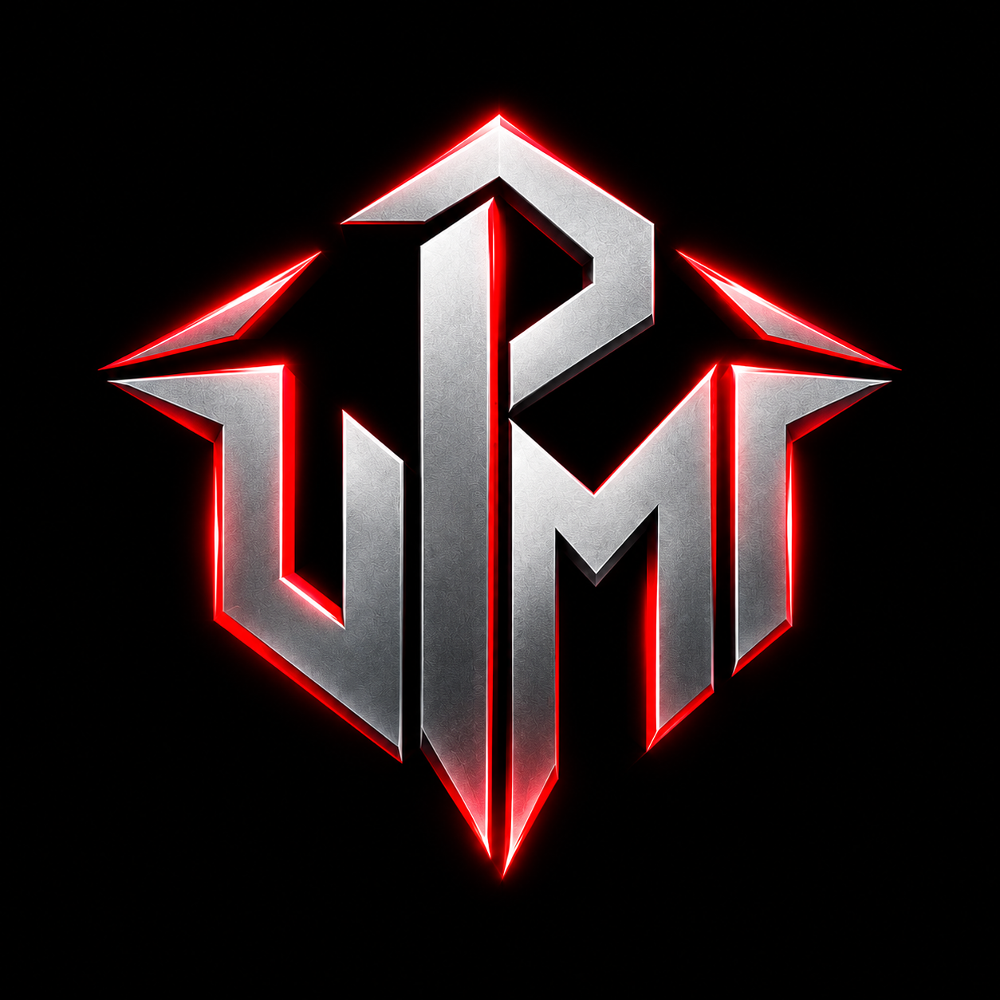

# UPMI Platform (Unknown People Meet & Interact)

Official web platform for **UPMI Esports** — India's competitive esports and social gaming community. Built for mobile battlegrounds gamers (BGMI, Free Fire) to meet, interact, find squadmates, join 25-slot custom rooms, and create professional match flyers.



---

## ⚡ Features

- **Dynamic Hero Arena**: 5 auto-rotating high-definition tournament banners with instant APK download and squad registration.
- **Tournaments & Live Scrims Hub**: Krafton-licensed scrims, 25-slot custom room grid, prize distributions, and real-time team registration.
- **Interactive Community Hub**:
  - **Fan MVP Poll**: Live community match predictions with real-time vote updates.
  - **BGIS 10-Point Calculator**: Official Krafton points system simulator for placement and finish score calculation.
  - **Hall of Fame**: Celebrating champions and tier-1 rosters.
  - **Tournament FAQ**: Comprehensive rules, device restrictions, and fair-play policies.
- **Slot Flyer Studio**: Built-in Canva-style designer exporting 1080×1350 HD match flyers for Instagram and WhatsApp status, with preset templates, custom color themes, and roster editing.
- **Verified Talent Directory**: Connect with certified BGMI coaches, casters, commentators, and tournament organizers.
- **Squad Finder (LFT/LFP)**: Community recruitment board for clans to discover aggressive assaulters, IGLs, snipers, and free agents.
- **Pro Club Store**: Exclusive VIP clan memberships, customized clan jerseys, and gaming gear.
- **Official APK Distribution**: Direct release build downloads (`stgapp-release.apk`).
- **Fully Responsive**: Mobile-first architecture supporting all screen viewports down to 320px with smooth swipeable navigation.

---

## 🚀 Tech Stack

- **Framework**: [Next.js](https://nextjs.org/) 16 (Turbopack, App Router)
- **UI Library**: React 19
- **Icons**: [Lucide React](https://lucide.dev/)
- **Styling**: Vanilla CSS with custom Cyber Titan Esports design system, responsive clamp typography, and dark-theme metallic gradients.

---

## 🛠️ Getting Started

### Prerequisites

- Node.js 18.18+ or later
- npm or pnpm

### Installation

1. Clone the repository:
   ```bash
   git clone https://github.com/Thiran360/UPMI-web.git
   cd UPMI-web
   ```

2. Install dependencies:
   ```bash
   npm install
   ```

3. Run the development server:
   ```bash
   npm run dev
   ```

4. Open [http://localhost:3000](http://localhost:3000) in your browser.

### Production Build

```bash
npm run build
npm run start
```

---

## 📄 License

© 2026 UPMI Esports (STG App). All rights reserved.
